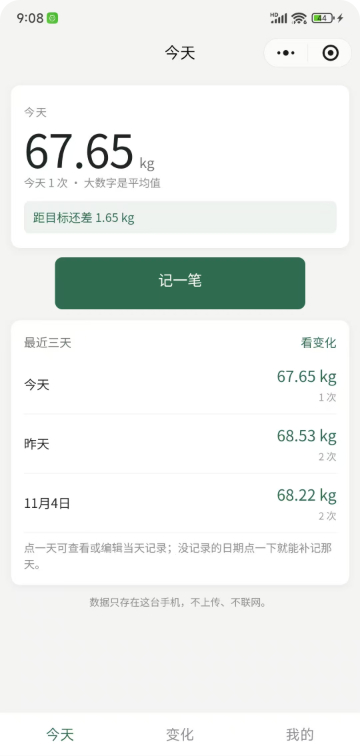
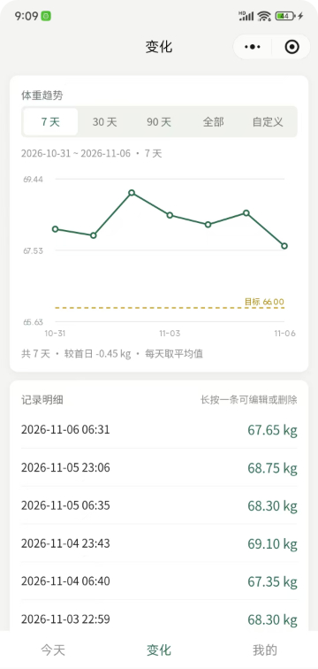
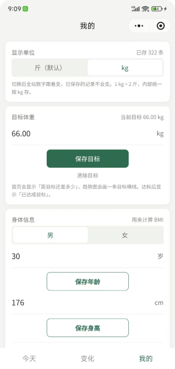

<h1 align="center">体重记录小刀盾</h1>

<p align="center">一个只给自己用的体重记录微信小程序：原生写法、纯本地存储、不联网、不依赖云开发。</p>

<p align="center">
  
  
  
  
</p>

> 说明：徽章文字用英文是为了保证在 shields.io 上稳定渲染；仓库为私有仓库，因此不使用依赖 stars / forks 等仓库指标的动态徽章。

## 目录

- [🚀 功能一览](#-功能一览)
- [📱 页面与截图](#-页面与截图)
- [🧮 BMI 说明](#-bmi-说明)
- [💾 数据与备份](#-数据与备份)
- [🔒 隐私说明](#-隐私说明)
- [🛠 快速开始](#-快速开始)
- [❓ 常见问题](#-常见问题)
- [🖼 如何给 README 加图](#-如何给-readme-加图)
- [🗂 目录结构](#-目录结构)
- [📝 更新记录](#-更新记录)
- [⚠️ 免责声明](#-免责声明)
- [📄 License](#-license)

## 🚀 功能一览

| 页面 | 能做什么 |
| --- | --- |
| 今天 | 显示当天平均体重；最近 3 个自然日（今天 / 昨天 / 前天）每天一行，没记录的日子保留「未记录」占位，点进去可以直接补记；显示与目标体重的差值或「已达成目标」 |
| 记一笔 | 选日期和时间、输入体重、写 40 字以内备注；已保存的记录可编辑或删除 |
| 变化 | 7 天 / 30 天 / 90 天 / 全部 / 自定义日期区间；canvas 2d 手绘折线图，每天一个点（取当天平均）；有目标时画一条目标横线；区间汇总（共几天、较首日变化）；下方列表长按可编辑或删除 |
| 我的 | 斤 / kg 单位切换、目标体重、身高 / 性别 / 年龄、BMI、导出 JSON / CSV、导入 JSON、清空数据 |

- **单位与精度**：界面默认「斤」，内部统一按 kg 存储，`1 kg = 2 斤`。切换单位只影响显示，不改动已保存的记录；**kg 显示 2 位小数，斤显示 1 位小数**（例如 134.7 斤 = 67.35 kg）。
- **一天多条**：当天平均体重、趋势图每天的数据点都按当天平均值计算，不会互相覆盖；平均值用原始 kg 求和后再除，最后按当前单位精度四舍五入。
- **输入校验**：体重 20–300 kg（40–600 斤）；kg 最多 2 位小数、斤最多 1 位小数，超出会明确提示且不保存；不能记录未来时间。
- **无依赖**：没有 npm 包、没有 CDN、没有 ECharts，图表用 canvas 2d 手绘，复制目录即可运行。

> 所有数据都留在本机，没有账号体系，也没有任何网络请求。

## 📱 页面与截图

| 页面 | 路径 | 主要内容 |
| --- | --- | --- |
| 今天 | `pages/today` | 当天平均、最近 3 天列表、目标差值 |
| 记一笔 | `pages/record` | 新增 / 编辑 / 删除单条记录 |
| 变化 | `pages/trend` | 区间折线图、目标横线、区间汇总、记录列表 |
| 我的 | `pages/profile` | 单位、目标、身体信息、BMI、导入导出、清空 |

<!--
截图占位：目前仓库里还没有截图文件，先保留注释，避免首页出现破图。
上传后删除本段注释，并把下面三行改成实际图片引用（即去掉每行前面的“# ”）。

# 
# 
# 
-->

建议文件名：

- `docs/screenshots/today.png`（今天页）
- `docs/screenshots/trend.png`（变化页）
- `docs/screenshots/profile.png`（我的页）

上传后把上面对应行改成 `` 这样的写法即可。

## 🧮 BMI 说明

公式：`BMI = 体重(kg) ÷ 身高(m)²`，用**最近一条**体重记录和「我的」里保存的身高计算。

| BMI（保留 1 位小数分类） | 分类 |
| --- | --- |
| < 18.5 | 过轻 |
| 18.5 – 23.9 | 正常 |
| 24.0 – 27.9 | 超重 |
| ≥ 28.0 | 肥胖 |

- 分类依据《成人体重判定》WS/T 428—2013；男女分界值相同，不做性别差异。
- 年龄参考区间：18–64 岁 18.5–23.9；65 岁及以上 20.0–26.9。
- 18 岁以下标注「成人标准不适用，仅供参考」。

> BMI 不区分肌肉与脂肪，只适合粗略参考；界面上的分类按显示出来的 1 位小数判断，避免四舍五入后数字和分类对不上。

## 💾 数据与备份

数据全部存在 `wx.setStorage` 里，只有两个键：

| 键 | 内容 |
| --- | --- |
| `weight_records_v1` | 体重记录数组 |
| `weight_settings_v1` | 单位、目标体重、身高、性别、年龄、备份时间等设置 |

单条记录：

```json
{
  "id": "r_1730000000000_ab12cd",
  "ts": 1730000000000,
  "weightKg": 60.55,
  "note": "",
  "createdAt": 1730000000000,
  "updatedAt": 1730000000000
}
```

导出的 JSON 备份（`settings` / `records` 即上面两个键的内容）：

```json
{
  "app": "weight-log-miniapp",
  "appVersion": "1.1.0",
  "schemaVersion": 1,
  "exportedAt": 1730000000000,
  "exportedAtText": "2026-11-05 12:00:00",
  "settings": {},
  "records": []
}
```

- **导出 JSON**：完整备份，含记录和设置，换手机可原样恢复；记录始终按 kg、2 位小数保存，备份结构不变。
- **导出 CSV**：给 Excel 看，表头用当前单位并附另一种单位（kg 列 2 位小数、斤列 1 位小数），带 BOM 防止中文乱码。
- **导入 JSON**：从聊天选择备份文件；导入前自动把当前数据备份成 `自动备份-时间戳.json`，再让你选「跳过重复（只新增）」或「覆盖本机」。旧备份里 1 位小数的记录导入后照常显示为 2 位（`67.4` → `67.40`），数值不变，也不会提示异常。
- **升级前备份**：1.1.0 首次启动且本机已有记录时，自动生成 `升级前备份-时间戳.json`，「我的」页会显示文件名。

**换手机迁移**：旧手机「我的」→ 导出 JSON → 发给「文件传输助手」→ 新手机打开小程序 → 我的 → 从聊天导入 JSON → 选择导入方式。

> 删除小程序、清理微信缓存或换手机都会让本地数据消失，请定期导出备份。

## 🔒 隐私说明

- 体重数据只存在本机小程序本地存储，**不上传、不联网、没有账号、没有云端**。
- 没有第三方统计 SDK、没有埋点、没有广告。
- 导出的文件只在你选择分享或保存的位置，不经过任何服务器。

## 🛠 快速开始

1. 安装并打开「微信开发者工具」。
2. 选择「导入项目」，目录选到本项目根目录。
3. AppID：`project.config.json` 里预填了一个 AppID，建议改成你自己的小程序 AppID；只想本地预览时也可以使用测试号。
4. 后端服务选择「**不使用云服务**」——本项目没有云函数、没有数据库、没有网络请求。
5. 点击「编译」运行。真机用「预览」扫码体验；从聊天导入 JSON 只在真机可用。

官方链接：

- [微信开发者工具下载](https://developers.weixin.qq.com/miniprogram/dev/devtools/download.html)
- [微信小程序开发文档](https://developers.weixin.qq.com/miniprogram/dev/framework/)
- [微信小程序平台运营规范](https://developers.weixin.qq.com/miniprogram/product/)（类目、隐私与内容相关要求以这里为准）
- [微信公众平台](https://mp.weixin.qq.com/)

## ❓ 常见问题

<details>
<summary>换手机后数据会自动同步吗？</summary>

不会。本项目没有云端，换手机前请先在旧手机「我的」里导出 JSON，再在新手机上从聊天导入。
</details>

<details>
<summary>为什么趋势图一天只有一个点？</summary>

折线图按「天」聚合，同一天记录多次时取当天平均值，所以一天只画一个点。
</details>

<details>
<summary>导入时「跳过重复」和「覆盖本机」有什么区别？</summary>

「跳过重复」只追加本机没有的记录；「覆盖本机」用文件里的记录替换现有记录，并把文件中的设置合并进来。两种方式都会在导入前自动备份当前数据。
</details>

<details>
<summary>为什么 BMI 显示「成人标准不适用」？</summary>

年龄填得小于 18 岁时会这样提示，成人 BMI 标准不适用于未成年人，结果仅供参考。
</details>

<details>
<summary>开发者工具里为什么不能导入 JSON？</summary>

导入用的是 `wx.chooseMessageFile`（从聊天选文件），只在手机微信里可用，请用真机预览后再试。
</details>

## 🖼 如何给 README 加图

**方式一：GitHub 网页上传（不用装软件）**

1. 打开仓库页面，点 `Add file` → `Upload files`。
2. 把截图拖进去；如果直接拖到根目录，文件名处手动改成 `docs/screenshots/today.png`，GitHub 会自动建好目录。
3. 填一句提交信息，点 `Commit changes`。

**方式二：GitHub Desktop**

1. 在本地项目里新建 `docs/screenshots/` 文件夹，放入截图（建议命名 `today.png`、`trend.png`、`profile.png`）。
2. 打开 GitHub Desktop，左侧会列出新增文件，填写提交信息后点 `Commit to main`。
3. 点 `Push origin` 推送到 GitHub。

**相对路径写法**

```markdown

```

- 路径区分大小写，文件名要和实际文件一致。
- 不要写本机绝对路径（如 `D:\...`），否则别人打开会破图。
- 图片和 README 都在仓库里时，用相对路径最稳。

## 🗂 目录结构

```text
.
├── app.js                 # 启动时初始化存储、执行升级前备份
├── app.json               # 页面路由与 tabBar
├── app.wxss               # 全局样式
├── project.config.json    # 开发者工具项目配置
├── sitemap.json
├── README.md
├── pages/
│   ├── today/             # 今天：当天平均、最近 3 天、目标差值
│   ├── record/            # 记一笔 / 编辑记录
│   ├── trend/             # 变化：区间折线图 + 记录列表
│   └── profile/           # 我的：单位、目标、身体信息、BMI、导入导出
├── utils/
│   ├── store.js           # 本地存储读写、字段兼容
│   ├── backup.js          # JSON / CSV 导出、导入解析、自动备份
│   ├── unit.js            # kg 与斤换算、范围校验
│   ├── date.js            # 日期时间格式化
│   ├── stats.js           # 区间过滤、按天聚合
│   └── bmi.js             # BMI 计算、分类、年龄参考区间
├── 操作手册.md
└── 体重小程序-初版功能框架.md
```

截图上传后会多出一个 `docs/screenshots/` 目录。

## 📝 更新记录

- `1.1.0`（2026-11）：首页最近记录改为最近 3 个自然日（含未记录占位）；变化页支持自定义日期区间；新增 BMI（性别 / 年龄 / 身高、分类、年龄参考区间、计算依据与免责声明）；首次启动自动生成升级前备份；显示精度区分单位（kg 2 位小数、斤 1 位小数）。
- `1.0.0`（2026-11）：初版。四个页面、本地存储、kg 与斤双单位、折线图与目标线、JSON / CSV 导出与导入。

当前备份格式：`schemaVersion: 1`。

## ⚠️ 免责声明

本小程序只用于个人体重记录与趋势查看，不构成医疗建议、诊断或治疗方案。BMI 等指标是粗略参考，不区分肌肉与脂肪。如有健康疑问，请咨询专业医生。

## 📄 License

本项目采用 [MIT License](LICENSE)。

你可以自由使用、修改、分发本项目（包括商用），但需保留版权声明与许可声明。完整条款见仓库根目录的 [LICENSE](LICENSE)。

Copyright (c) 2026 windmemo
